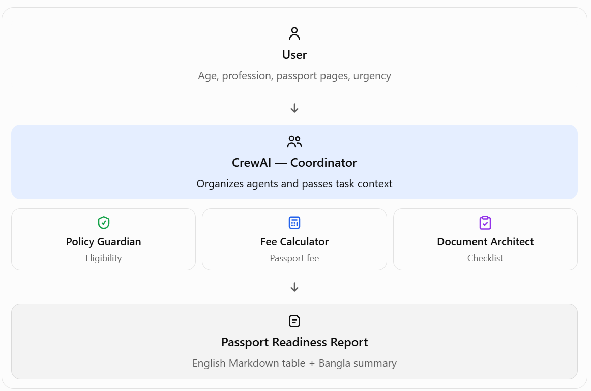

# Amar Passport — Bangladesh E-Passport Readiness AI Agent

A CrewAI multi-agent educational project that creates a Passport Readiness Report in English and Bangla using an applicant's age, profession, passport page count, requested validity, delivery urgency, and document status.

> **Important:** This is an educational helper, not an official government service. Always confirm eligibility, required documents, fee amounts, and processing times at the official portal before applying.

## Features

- **Policy Guardian:** reviews age, identity-document guidance, and eligibility conflicts.
- **Chancellor of the Exchequer:** calculates the exact BDT fee using the reviewed 2026 local fee table, including 15% VAT.
- **Document Architect:** prepares a tailored checklist for adults, minors, government employees, and name changes.
- **Task context:** the fee task receives the Policy Guardian task as context.
- **Validation:** flags an under-18 applicant requesting a 10-year or 64-page passport.
- **Fallback:** if the official page cannot be fetched or the LLM fails, local JSON data and deterministic checks still produce a report.
- **Bilingual output:** English Markdown table plus Bangla summary and checklist.
- **Verbose execution:** `verbose=True` helps inspect agent/task execution in the terminal.

## Project structure

```text
amar_passport_ai_agent/
├── data/
│   └── passport_reference.json
├── src/
│   └── amar_passport.py
├── .env.example
├── .gitignore
├── README.md
└── requirements.txt
```

## Requirements

- Python 3.10+ (use a currently supported version compatible with the CrewAI release you install)
- API key for the configured OpenAI-compatible provider
- Internet access for optional official-page fetch and LLM requests

## Setup on Windows PowerShell

Open PowerShell in this project folder:

```powershell
py -m venv .venv
.\.venv\Scripts\python.exe -m pip install --upgrade pip
.\.venv\Scripts\python.exe -m pip install -r requirements.txt
Copy-Item .env.example .env
notepad .env
```

Edit `.env` and set the real key locally:

```dotenv
API_KEY=your_real_api_key
BASE_URL=https://api.cheaperinference.com/v1
MODEL_NAME=glm-5.3
```

## Run

```powershell
.\.venv\Scripts\python.exe src\amar_passport.py
```

Answer the prompts. The generated report is printed in the terminal and saved as `passport_readiness_report.md` in the project folder.

## Example scenario

Input:
"I am a 24-year-old private sector employee. I need a 64-page passport urgently because I have a business trip in two weeks. I have an NID and I live in Dhaka."
- Requested validity: 10
- Name change: no

Expected fee from the current local reference table: **BDT 10,350**, inclusive of 15% VAT. Actual eligibility and delivery availability should be confirmed on the official portal.

## Test the policy guardrail

Try an applicant age of `15` with requested validity `10`. The program should flag the contradiction and not finalize a fee.

## Policy and fee notes

The local table records the domestic fees listed on the official portal:
https://www.epassport.gov.bd/instructions/passport-fees

Fee amounts already include 15% VAT. The script does **not** add VAT a second time.

The assignment mentions restrictions for applicants under 18 and over 65. The project enforces the under-18 5-year/48-page guardrail and flags applicants over 65 for manual confirmation rather than inventing a definitive rule. Verify all rules with the passport office.

The page fetch is a best-effort connectivity check. Because government website HTML can change, it does not automatically overwrite the reviewed local table. Update `data/passport_reference.json` only after checking the official source.

## Agent workflow

```text
Applicant profile
       |
       v
Deterministic validation + local database
       |
       v
Policy Guardian
       |
       v
Fee Calculator (Policy Guardian task passed as context)
       |
       v
Document Architect
       |
       v
English Markdown table + Bangla summary


```

If the API key is missing, the LLM request fails, or web scraping is unavailable, the deterministic local fallback is used.

## GitHub upload

Create an empty repository on GitHub, for example `amar-passport-ai-agent`. Then run these commands from the project folder:

```powershell
git init
git add .
git status
git commit -m "Build Amar Passport CrewAI multi-agent project"
git branch -M main
git remote add origin https://github.com/ahmmadhossain/amar-passport-ai-agent.git
git push -u origin main
```

```powershell
git status
git check-ignore .env
```